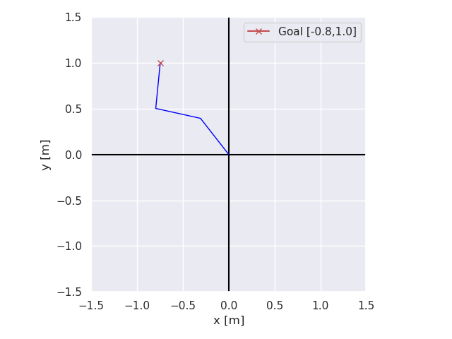
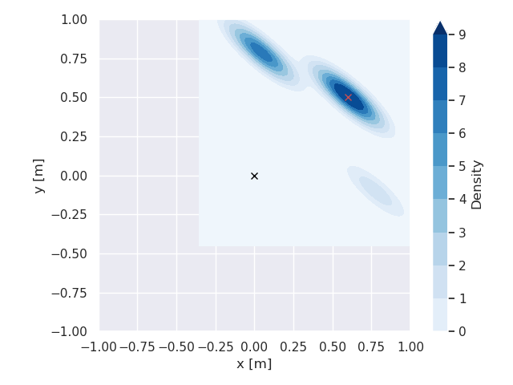

# Learning-based Inverse Kinematics

This repository contains code to train and compare:
- Analytical supervised models for inverse kinematics (direct and probabilistic outputs)
- Reinforcement Learning (PPO) agents using Stable-Baselines3

It includes synthetic problem generation, visualization utilities, hyperparameter optimization with Optuna, and benchmarking scripts.

- Entry point: [scripts/main.py](scripts/main.py) via [`main`](scripts/main.py)
- Training orchestration: [networks/train_and_test_models.py](networks/train_and_test_models.py) via [`train_and_test_model`](networks/train_and_test_models.py)
- Optuna: [hyperparameter_optimization/optuna_utils.py](hyperparameter_optimization/optuna_utils.py) via [`run_optuna`](hyperparameter_optimization/optuna_utils.py)
- IK Environment (RL): [networks/stb3/kinematics_environment.py](networks/stb3/kinematics_environment.py) via [`KinematicsEnvironment`](networks/stb3/kinematics_environment.py)
- Data generation: [data_generation/parameter_generator.py](data_generation/parameter_generator.py) via [`ParameterGeneratorForPlanarRobot`](data_generation/parameter_generator.py), and [data_generation/goal_generator.py](data_generation/goal_generator.py) via [`generate_achievable_goal`](data_generation/goal_generator.py)
- Visualization: [vis/planar_robot_vis.py](vis/planar_robot_vis.py) via [`visualize_planar_robot`](vis/planar_robot_vis.py)

## Key Results

Supervised models on planar arms with 2 and 3 joints (link lengths 0.3–0.5 m), each evaluated on 10,000 test problems. A problem counts as solved when the end effector lands within 1 cm of the goal. Accuracy is the mean of 5 runs; inference time is the mean single-query runtime over 1,000 repeats. Full numbers: [comparison_results/summaries/performance_summary.txt](comparison_results/summaries/performance_summary.txt).

| Model | Solved (2 joints) | Solved (3 joints) | Inference (2 / 3 joints) |
|---|---|---|---|
| **Direct MLP** (`SimpleKinematicsNetwork`) | **100 %** | **100 %** | **154 / 157 µs** |
| Two-peak Normal, MLP (`TwoPeakNormalDistrNetwork`) | 99.94 % | 99.72 % | 269 / 337 µs |
| One-peak Normal, LSTM (`NormalDistrRandomSampleLSTMDistNetwork`) | 99.96 % | 93.25 % | 474 / 526 µs |
| One-peak Normal, MLP (`NormalDistrManualReparameterizationNetwork`) | 97.50 % | 75.59 % | 321 / 372 µs |
| Two-peak Normal, LSTM (`TwoPeakNormalLstmDistrNetwork`) | 67.71 % | 92.99 % | 366 / 514 µs |
| Two-peak Normal, LSTM+MLP (`TwoPeakNormalLstmVariantDistrNetwork`) | 91.21 % | 67.63 % | 759 / 863 µs |
| Beta, MLP (`BetaDistrRSampleMeanNetwork`) | 5.19 % | 8.48 % | 207 / 257 µs |
| PPO, Stable-Baselines3 ([networks/stb3](networks/stb3)) ¹ | 69.98 % | 56.45 % | 444 / 465 µs |

¹ PPO numbers are from Table 5.1 of the thesis, not from `performance_summary.txt`. PPO was trained for 50M (2 joints) and 45M (3 joints) environment steps instead of 10,000 epochs, with a mean end-effector error of 13.6 mm and 20.4 mm.

The simplest model, a direct MLP regressing joint angles, solved every test problem and had the fastest inference. PPO trailed the MLP and LSTM models and took far longer to train (1.5–3.7 · 10⁵ s vs. about 600 s): it is built for multi-step tasks, and IK here is a single-step problem. Of the probabilistic models, the two-peak Normal distribution came closest. The two-peak models also capture that most goals have two valid solutions (elbow up / elbow down):

| Direct MLP, 3 joints | Two-peak LSTM: end-effector density, 2 joints |
|---|---|
|  |  |

## Setup

- Create and activate the environment:
```bash
conda env create -f environment.yml -n thesis_env
conda activate thesis_env
```

## Run Training

Hydra is used for configuration. Default config: [conf/config.yaml](conf/config.yaml).

- Train with current config (analytical or RL depending on `use_stb3`):
```bash
# Option A (from repo root)
python -m scripts.main

# Option B
cd scripts
python main.py
```

- Switch between analytical and RL:
  - In [conf/config.yaml](conf/config.yaml): set `use_stb3: false` (analytical) or `true` (RL).
  - Analytical model type and hyperparams live under `hyperparams.analytical.*` (see [conf/hyperparams/hyperparams.yaml](conf/hyperparams/hyperparams.yaml)).
  - RL hyperparams live under `hyperparams.stb3.*`.

- Override configs from CLI (Hydra):
```bash
python -m scripts.main number_of_joints=3 hyperparams.analytical.batch_size=256 logging.log_in_console=true
```

## Hyperparameter Optimization (Optuna)

- Enable by setting `use_optuna: true` in [conf/config.yaml](conf/config.yaml).
- Then run:
```bash
python -m scripts.main
```
- Study uses SQLite storage `performance.db`. See [`run_optuna`](hyperparameter_optimization/optuna_utils.py).

## Visualizations

- Training visualizations are controlled by `vis.*` in [conf/config.yaml](conf/config.yaml) and dataclasses in [conf/conf_dataclasses/vis_config.py](conf/conf_dataclasses/vis_config.py).
- Visualize a saved analytical model:
  - Script: [scripts/visualize_analytical_model_file.py](scripts/visualize_analytical_model_file.py)
```bash
python scripts/visualize_analytical_model_file.py
```
  The script uses the clipboard path by default; or set `model_file_path` inside the script.

## Evaluate and Benchmark

- Evaluate all saved models in a folder:
  - Script: [scripts/test_model_file.py](scripts/test_model_file.py) via `test_models_in_folder`
```bash
python scripts/test_model_file.py
```

- Measure single vs batched inference runtimes for a saved model:
  - Script: [scripts/test_runtimes.py](scripts/test_runtimes.py)
```bash
python scripts/test_runtimes.py
```

- Run the main script multiple times and summarize runtimes:
  - Script: [scripts/benchmark_script.py](scripts/benchmark_script.py)
```bash
python scripts/benchmark_script.py
```

- Batch-run multiple configurations and summarize results:
  - Script: [scripts/run_various_confs.py](scripts/run_various_confs.py)
    - Warning: It updates [conf/hyperparams/hyperparams.yaml](conf/hyperparams/hyperparams.yaml) and [conf/config.yaml](conf/config.yaml).
```bash
python scripts/run_various_confs.py
```

## Logging

- Console/W&B logging is managed by [`GeneralLogger`](custom_logging/custom_loggger.py).
- Configure in [conf/config.yaml](conf/config.yaml) under `logging.*` (see [conf/conf_dataclasses/logging_config.py](conf/conf_dataclasses/logging_config.py)).
  - Enable W&B: `logging.wandb.log_in_wandb: true`.

## Project Structure (high level)

- configs: [conf/](conf/)
- training and evaluation: [networks/](networks/)
- data generation: [data_generation/](data_generation/)
- visualization: [vis/](vis/)
- scripts/CLI: [scripts/](scripts/)
- utilities: [util/](util/)

## Notes

- A portion of [util/batched.py](util/batched.py) is adapted from PyTorch3D (BSD License).
- Models are saved to the directory set by `model_save_dir` in [conf/config.yaml](conf/config.yaml).
